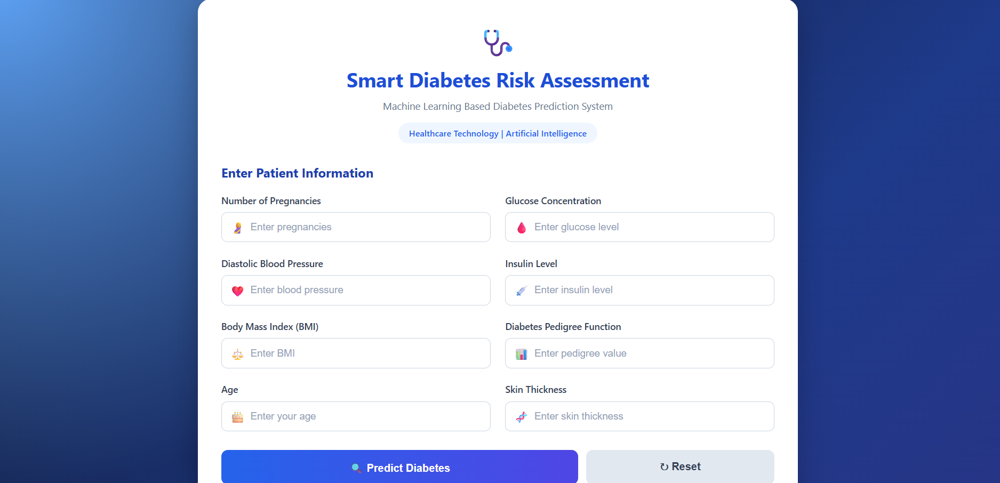

# 🩺 Smart Diabetes Risk Assessment

### Machine Learning Based Diabetes Prediction System

A Machine Learning-based web application that predicts diabetes using patient health information. The application uses a trained Random Forest classification model and provides predictions through a user-friendly Flask web interface.

---

## 📌 1. Project Overview

The Smart Diabetes Risk Assessment project aims to predict diabetes based on patient medical information using Machine Learning techniques.

The system accepts health-related inputs, performs data preprocessing, applies feature scaling, and uses a trained Random Forest model to generate predictions.

The application is developed using Python and Flask.

## 🎯 2. Project Objectives

- Predict diabetes using Machine Learning.
- Perform data cleaning and preprocessing.
- Handle missing values using SimpleImputer.
- Apply feature scaling using StandardScaler.
- Compare different classification algorithms.
- Develop a user-friendly web application using Flask.
- Generate predictions based on patient input.

## 🛠️ 3. Technologies Used

| Technology | Purpose |
|---|---|
| Python | Programming Language |
| Pandas | Data Manipulation |
| NumPy | Numerical Operations |
| Matplotlib | Data Visualization |
| Scikit-learn | Machine Learning |
| Flask | Web Application |
| Jupyter Notebook | Model Development |
| HTML | Web Page Structure |
| CSS | Web Page Styling |
| Pickle | Model Serialization |

## 🤖 4. Machine Learning Algorithms

The following classification algorithms were implemented and compared:

1. Naive Bayes
2. Random Forest Classifier
3. K-Nearest Neighbors (KNN)
4. Support Vector Machine (SVM)

**Selected Model:** Random Forest Classifier

The trained Random Forest model is integrated into the Flask application for diabetes prediction.

## 📊 5. Model Performance

The notebook reports the following Random Forest model accuracy:

| Model | Accuracy |
|---|---:|
| Random Forest | 75% |

**Note:** This is the accuracy reported in the project notebook. Performance may vary with different datasets and evaluation conditions.

## 📁 6. Project Structure

```text
Diabetes-Prediction-ML/
│
├── app.py
├── diabetes Model_new_final.ipynb
├── rf_model.pkl
├── scaler.pkl
├── imputer.pkl
├── requirements.txt
├── .gitignore
├── README.md
│
├── templates/
│   └── index.html
│
├── diabetes-home.png.png
└── diabetes-result.png.png
```

## ⚙️ 7. Installation and Execution Steps

### Step 1: Clone the Repository

```bash
git clone https://github.com/Arya-gunji/Diabetes-Prediction-ML.git
```

### Step 2: Navigate to Project Folder

```bash
cd Diabetes-Prediction-ML
```

### Step 3: Install Required Libraries

```bash
pip install -r requirements.txt
```

### Step 4: Run the Flask Application

```bash
python app.py
```

### Step 5: Open in Browser

```text
http://127.0.0.1:5000/
```

Enter the required patient information and click the Predict Diabetes button to view the model prediction.

## 📸 8. Project Screenshots

### Home Page


### Prediction Result



## 👨‍💻 9. Author Details

**Arya Gunji**

B.Tech – Information Technology

Interested in Data Science, Machine Learning, Python and Generative AI.

- **GitHub:** [Arya-gunji](https://github.com/Arya-gunji)
- **LinkedIn:** [Arya Gunji](https://www.linkedin.com/in/arya-gunji/)

---

## ⚠️ Disclaimer

This project is developed for educational purposes only. Its predictions are not a substitute for professional medical advice, diagnosis, or treatment.

---

⭐ If you find this project useful, feel free to explore the repository!
